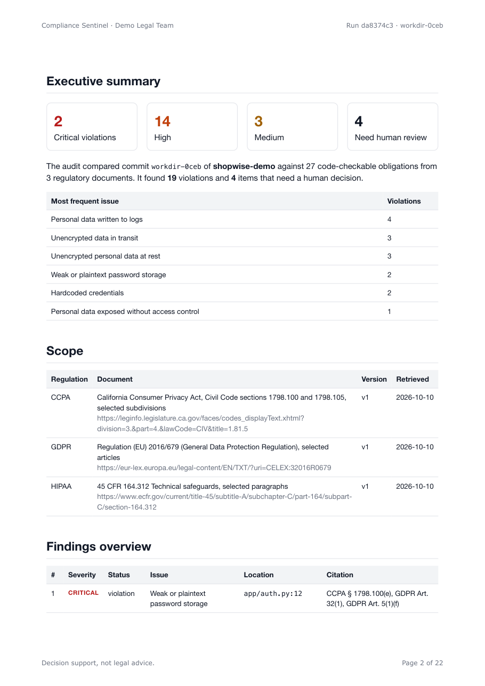
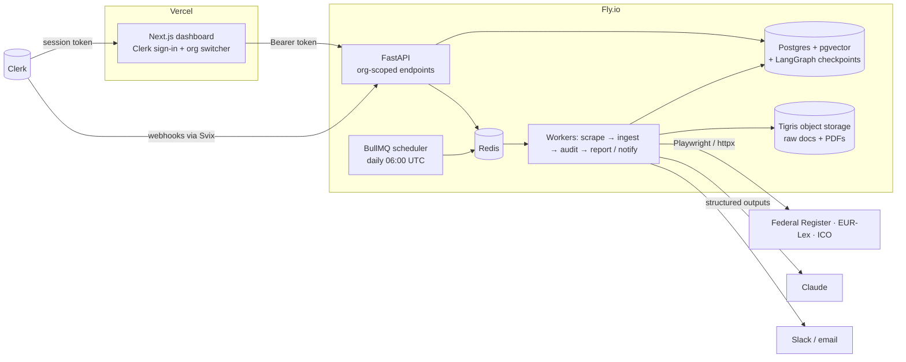
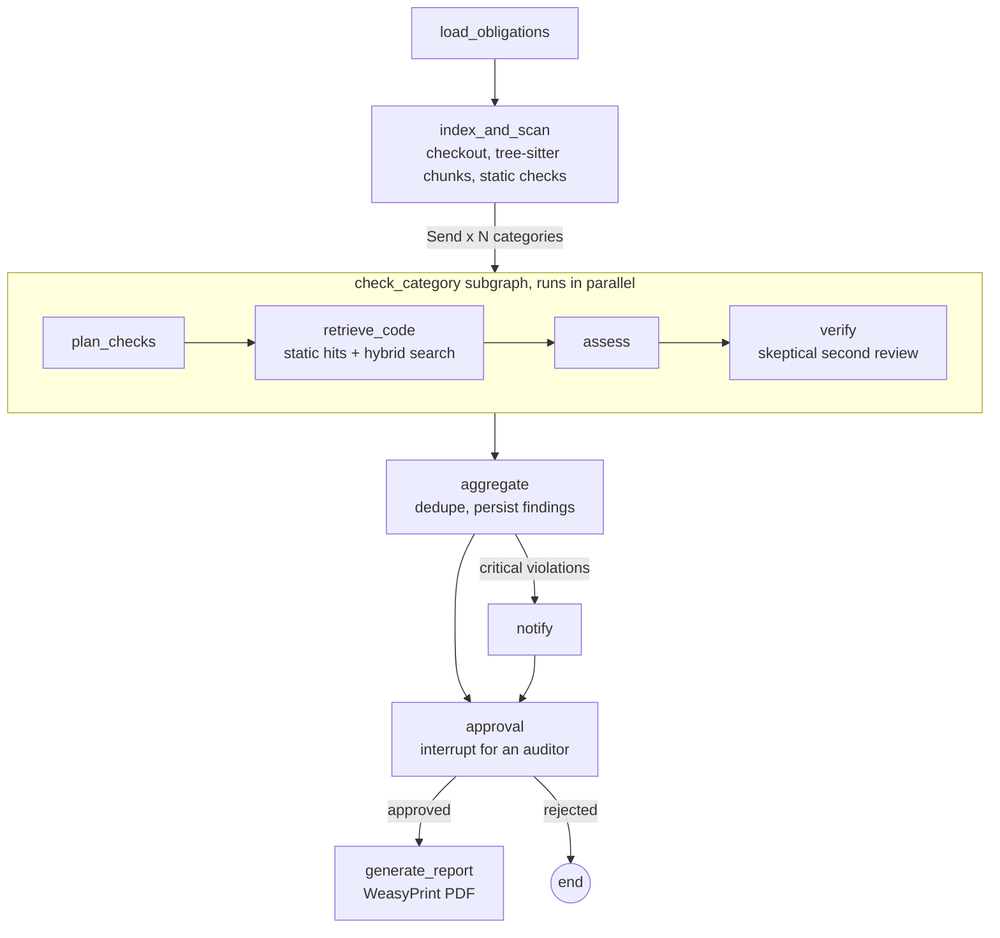

# Compliance Sentinel

A LangGraph agent that watches regulatory sources, turns new rules into checkable obligations,
audits a codebase against them, and produces an audit-ready PDF report with a citation for every
finding. Legal and engineering teams sign in with Clerk, and each team only sees its own repos,
runs and reports.



**Built with:** LangGraph · Claude (Anthropic SDK, structured outputs) · Playwright · Postgres +
pgvector · BullMQ on Redis · FastAPI · Next.js + Clerk · WeasyPrint · Fly.io

- [Sample report (PDF)](docs/sample-report.pdf), produced by the offline demo below
- [Build plan](PLAN.md), the original design this implements

---

## What it does

1. **Scrapes** regulatory sources on a daily BullMQ schedule. The Federal Register uses its JSON
   API. EUR-Lex and guidance pages fall back to headless Chromium when plain HTTP is blocked.
2. **Ingests** each changed document. It splits the text along the law's own numbering, so every
   chunk has an exact citation such as `GDPR Art. 32(1)(a)` or `CCPA § 1798.105(c)(1)`. It embeds the
   chunks into pgvector and extracts structured obligations with Claude.
3. **Diffs amendments.** Only chunks whose text changed are re-embedded and re-extracted, and only
   new obligations trigger a re-audit of affected repos.
4. **Audits** each repo with a LangGraph agent. Static privacy checks and hybrid code search
   gather evidence, Claude assesses it, and a second review confirms each violation.
5. **Alerts** Slack and email when there are critical violations.
6. **Pauses for approval.** An auditor approves the run in the dashboard, and their name goes into
   the PDF's signature block.

## Architecture



### The audit graph



The graph uses a Postgres checkpointer, so a run paused for approval can resume in any worker
process. Dependencies such as the database, the model client and the embedder are passed through
LangGraph's runtime context, so they are never written into checkpoints.

**One parallel check per category, not per obligation.** GDPR Art. 32(1), Art. 5(1)(f) and
CCPA § 1798.100(e) all bear on password storage. Checking the same code once per category, with
every relevant obligation attached as a citation, cuts model calls without losing any citation.

## Results

Measured on [`demo-target-repo`](demo-target-repo), a small shop and clinic backend with 26 planted
violations and 11 compliant look-alikes. The answer key is in [`evals/golden.yaml`](evals/golden.yaml),
outside the audited repo. Full output: [`docs/eval-offline.json`](docs/eval-offline.json).

| Metric | Offline engine |
|---|---|
| Precision (confirmed violations) | 1.00 |
| Recall (confirmed violations) | 0.73 |
| Recall including items marked for review | 0.88 |
| Recall on the 3 "hard" violations | 0.00 |
| False alarms on the 11 look-alikes | 0 |
| Citations whose quote appears in the stored legal text | 100% |
| Retrieval recall@5 on 15 legal questions | 0.80 |
| Cost per audit | $0.00 |

**How to read this honestly:**

- These numbers come from the **offline heuristic engine**, which runs without an API key. The
  Claude engine is implemented and unit-tested against a fake client. It has **not been scored yet**,
  because no Anthropic key was available while building. Run `make demo` with `ANTHROPIC_API_KEY` set
  to measure it.
- The static rules and the demo repo were written together, so "easy" recall is optimistic. The
  three "hard" violations need reasoning: personal data logged through a generic variable name,
  personal data cached unencrypted in Redis, and tracking without a consent check. The offline engine
  misses all three by design. They are the cases the Claude engine is for.
- The "saves legal teams 40+ hours/week" claim from the original brief has not been measured.
  The plan describes how to measure it.

## Quickstart (offline, no keys needed)

Requires Docker, [uv](https://docs.astral.sh/uv/) and, on macOS, `brew install pango` for PDFs.

```bash
make setup     # Python deps + Chromium for Playwright
make demo      # Postgres/Redis up, migrate, seed, scrape bundled regulations, audit, PDF, eval
make amendment # ingest a labeled SYNTHETIC amendment and watch the targeted re-audit start
make test      # 34 tests, including tenant isolation and a full pipeline run
```

The PDF lands in `data/reports/`. Run `make demo` again after setting keys to use the real services.

### With Claude and Voyage

```bash
cp .env.example .env
# set ANTHROPIC_API_KEY (or run `ant auth login`) and optionally VOYAGE_API_KEY
make demo
```

Claude calls use `claude-opus-5-5` with structured outputs (`messages.parse` + Pydantic schemas),
explicit effort per step, prompt caching and server-side refusal fallback. Every run logs its tokens
and cost. Two guards stop the model from inventing things:

- **Quotes are checked.** An extracted obligation is dropped unless its quote appears in the source text.
- **Locations come from the repo.** The model can only refer to evidence by ID. File paths, line
  numbers and code snippets always come from the repository itself.

### Dashboard and Clerk

```bash
cd web && npm install
npx clerk@latest init --accountless --template b2b-saas   # temporary dev keys, no account needed
cd .. && make api      # FastAPI on :8000, AUTH_MODE=dev, audits run in-process
make web               # Next.js on :3000
```

In local dev the dashboard forwards the Clerk user, org and role to an API running `AUTH_MODE=dev`.
In staging and production the API verifies Clerk session tokens itself with `clerk-backend-api`. It
handles both Clerk token formats; v2 nests the org under `o`, which the SDK's helper does not read.
This path was checked against a live Clerk dev instance: no token and tampered tokens get 401, and a
real token resolves the org and the `org:admin` role.

| Role | Can do |
|---|---|
| `org:admin` | Add repos, trigger runs, change alert settings, everything below |
| `org:auditor` (custom role) | Approve or reject runs, mark findings as accepted risk or false positive |
| `org:member` | View runs, findings and reports |

Create the custom `org:auditor` role in the Clerk dashboard. Point a Clerk webhook at
`POST /webhooks/clerk` for user, organization and membership events.

## Deploying to Fly.io

```bash
fly launch --no-deploy            # uses fly.toml: api + worker process groups, Frankfurt region
fly postgres create               # or Neon; run CREATE EXTENSION vector
fly redis create                  # Upstash
fly storage create                # Tigris bucket; sets AWS_* and BUCKET_NAME secrets
fly secrets set DATABASE_URL=... REDIS_URL=... S3_BUCKET=... ANTHROPIC_API_KEY=... \
  VOYAGE_API_KEY=... CLERK_SECRET_KEY=... CLERK_JWT_KEY=... \
  CLERK_AUTHORIZED_PARTIES=https://your-dashboard.vercel.app \
  CLERK_WEBHOOK_SIGNING_SECRET=... INTERNAL_API_TOKEN=... RESEND_API_KEY=...
fly deploy                        # release step runs migrations and registers the daily schedule
```

Deploy `web/` to Vercel with `NEXT_PUBLIC_CLERK_PUBLISHABLE_KEY`, `CLERK_SECRET_KEY`,
`SENTINEL_API_URL` and `SENTINEL_AUTH_MODE=clerk`. The Docker image bakes in Chromium and the
tree-sitter grammars, so audits never depend on a runtime download. The settings refuse to start in
production with dev auth.

Not yet done: the Fly.io and Vercel deployments themselves, and the Loom demo.

## Report integrity

Each finding in the PDF shows the code with real line numbers, the reasoning, a confidence score,
and every breached obligation. Each obligation is quoted verbatim, with its source URL and retrieval
date. The cover shows a SHA-256 digest of a canonical JSON manifest of the run: documents and their
hashes, the commit, and every finding. The SHA-256 of the PDF file itself is stored on the report
record, returned in an `X-Content-SHA256` header, and written next to the file, since a file cannot
contain its own hash.

## Data sources

| Source | Method | Status |
|---|---|---|
| Bundled excerpts of GDPR, CCPA and HIPAA | Local files | On by default; used by the demo and tests |
| US Federal Register | Official JSON API | Off by default; fetched live during development |
| EUR-Lex (GDPR) | HTTP, then Playwright when challenged | Off by default; fetched live, and the saved page is a test fixture |
| UK ICO guidance | Playwright, selectors in config | Off by default; **not yet run live** |

Turn sources on in the `sources` table. The bundled excerpts are for demos and must be checked
against the official texts. The amendment in `sentinel/fixtures/regulations/demo-amendments/` is
**synthetic** and labeled as such inside the file and in the report.

## Project layout

```
sentinel/
  scrapers/   Federal Register, EUR-Lex, guidance pages, bundled fixtures; polite HTTP client
  ingest/     HTML/PDF parsing, citation-aware chunking, version diffs, obligation extraction
  rag/        hybrid retrieval: pgvector + IDF-weighted full-text search, weighted RRF, Voyage rerank
  codebase/   repo checkout, tree-sitter chunking, static privacy checks, optional Semgrep rules
  agent/      LangGraph graph, nodes, state, runner with the Postgres checkpointer
  report/     Jinja2 template and WeasyPrint rendering
  notify/     Slack Block Kit and Resend email
  queue/      BullMQ queues, workers, daily schedule, dead-letter queue
  auth/       Clerk token verification and role checks
  api/        FastAPI app and Clerk webhooks
web/          Next.js dashboard with Clerk
evals/        golden labels, legal retrieval questions, scorer
demo-target-repo/  the audited demo app (do not use its code)
```

This is decision support for a legal and engineering review. It is not legal advice.
